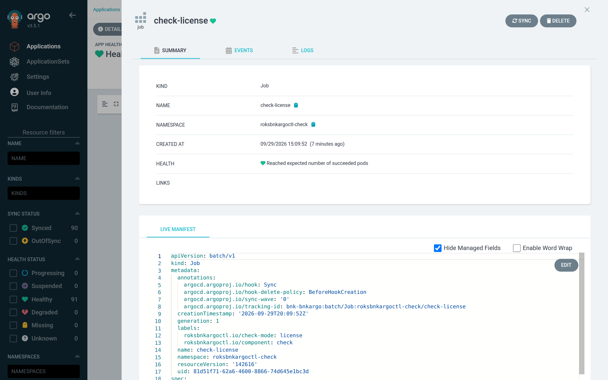

# Running with Argo CD Web Interface

This chapter is for operators who run BNK from the Argo CD web interface rather than from
`roksbnkargoctl`. It covers the one step that still needs the CLI, how to sync and watch an
install in the UI, how to upgrade BNK in place, how to delete the Application, and what a
delete from the UI leaves behind. The button and dialog names are those of Argo CD 3.5.1.

## What the UI can do, and what it cannot

Everything Argo CD owns can be driven from the UI: syncing, upgrading by changing Git, and
deleting. Some of what an install needs is not in Git, so Argo CD cannot create it:

| Not in Git | Why | Created by |
|---|---|---|
| The FAR pull secret, the subscription JWT, and in disconnected mode the FLP root CA | Secret values never go to Git | `roksbnkargoctl install` |
| Namespace `roksbnkargoctl-check` and its RBAC | Must outlive the Application, for the PostDelete hook | `roksbnkargoctl install` |
| The IAM trusted profile | An IBM Cloud object, not a Kubernetes one | `roksbnkargoctl install` |
| The cluster's registration on the hub, the Git repository and chart registry entries | Argo CD settings | `roksbnkargoctl install` |

[Chapter 7](./07-the-application.md#what-is-not-in-git-and-why) lists them all. So the first
install, and any re-install after the Application was deleted, starts with one command.
After that, everything in this chapter is done in the UI.

## Install: create the Application, sync it in the UI

```sh
roksbnkargoctl install --no-sync -w <workspace>
```

`--no-sync` does everything `install` does except the sync: it writes the out-of-band objects,
publishes the manifests to Git, registers the cluster, the repository and the registries,
and creates the Application. It ends with
`sync it from the Argo CD UI, or run roksbnkargoctl install without --no-sync`.

In the UI:

1. **Applications**: the Application (`argocd.application` in the workspace, `bnk-<workspace>`
   unless you named it) shows `OutOfSync` and `Missing`.
2. Open it and press **Sync**. The panel reads *Synchronizing application manifests from*
   your repository. Leave everything as it is:

   | Field | Keep | Why |
   |---|---|---|
   | Revision | as shown (`git.branch`) | |
   | **Prune**, **Dry Run**, **Apply Only**, **Force** | unchecked | Nothing to prune on a first sync |
   | **Sync Options** | as pre-filled from the Application: **Server-Side Apply**, **Respect Ignore Differences**, **Prune Last** checked | The Application needs them; FLO's CRDs are too large for a client-side apply |
   | **Replace** (if your hub allows it) | unchecked | Replace deletes and recreates objects |

3. Press **Synchronize**.


*The resource tree during the first sync: waves apply in order, and the sync waits at each hook.*

The sync runs in waves, and four checks run as hooks. The status bar names each one while
Argo CD waits for it:

| Wave | What is applied | Hook that runs |
|---|---|---|
| −20 | Namespaces `cert-manager`, `f5-bnk` | |
| −18 | The node-probe DaemonSet | `check-pre-install` (Sync): the cluster can run BNK |
| −6 | FLO's SCC binding, the Gateway API sweep, the NetworkAttachmentDefinition | |
| 0 | cert-manager and FLO charts | |
| 1 | | `check-cert-manager-ready` (Sync) |
| 2–4 | ClusterIssuers and the CA Certificate | |
| 6 | CNEManifest `bnk-<release>` | |
| 8 | CNEInstance `f5-bnk-f5-cne-controller`: FLO now deploys BNK | |
| 10 | | `check-license` (Sync): builds the License, waits for it to be Active |
| after | | `check-post-install` (PostSync) |



*`check-license` is the longest wait, while FLO brings BNK up and CWC activates the License.*

The sync is done when **Last Sync** shows `Sync OK` and the Application is `Synced` and
`Healthy`. A first install on a three-worker cluster took 8 to 9 minutes. Two things look
wrong but are not: while BNK's CRDs are still being created the status bar reads
`waiting for healthy state of …CustomResourceDefinition/…` for up to a minute, and the
Application is `OutOfSync` until the CNEManifest and CNEInstance exist.

A hook that fails stops the sync with the hook's message. Its verdict is the last line of
the pod's log: click the Job in the tree, then **Logs**. The
[checks reference](./16-checks.md) explains each finding.

## Watching a running install

| Want to see | In the UI |
|---|---|
| Whether BNK is up | The CNEInstance `f5-bnk-f5-cne-controller` → **Summary** → **Live Manifest**: `status.conditions`, every `*Available` True |
| The release running | The same CNEInstance: `spec.manifestVersion` |
| The license | Is not in the tree: the License is created by the `check-license` hook. `roksbnkargoctl status` reads it |
| What differs from Git | **Diff** |
| Pick up a new commit now, not at the next poll | **Refresh**; **Hard Refresh** also re-renders the charts |

Do not change BNK objects in the cluster by hand. Argo CD shows them `OutOfSync`, and the
next sync puts Git's version back.

## Upgrade within 2.4 with Git and Argo CD only

FLO upgrades BNK in place when the CNEInstance asks for a newer release. With Git as the
source of truth, an upgrade is a one-line commit and a **Sync**. Changing the objects in the
Argo CD UI instead does not last: Argo CD shows the Application `OutOfSync`, and the next sync
puts Git's version back.

Where each part of the release is recorded:

| What | Source of truth | Changed by |
|---|---|---|
| The BNK release FLO runs | `spec.manifestVersion` of the CNEInstance, in Git | A commit |
| The FLO chart version | The Application's `spec.sources`, on the hub (not in Git, see [#45](https://github.com/jgruberf5/roksbnkargoctl/issues/45)) | **Details** → **Manifest** → **Edit** |
| The release `roksbnkargoctl` renders | `bnk.version` in the workspace's `config.yaml`, and the build | Editing `config.yaml`; using the matching build |

### 1. Change the release in Git

In `git.path`, edit the CNEInstance file (`015-cneinstance-<namespace>-<namespace>-f5-cne-controller.yaml`,
`015-cneinstance-f5-bnk-f5-bnk-f5-cne-controller.yaml` by default). Change one line:

```diff
-  manifestVersion: 2.4.2
+  manifestVersion: 2.4.3
```

Commit and push. Nothing else in Git has to change.

### 2. Refresh and sync

In the Application, press **Refresh**: it shows `OutOfSync` on the CNEInstance. Press
**Sync** and keep the defaults (**Prune** is not needed), then **Synchronize**.

FLO reads the new `manifestVersion`, finds no CNEManifest for it, and pulls the release's
manifest from the registry itself (its log reads `Manifest version not found, retrieving from
remote registry`, then `Pulled: repo.f5.com/release/f5-bigip-k8s-manifest:2.4.3`). It creates
the CNEManifest `bnk-2.4.3`, then rolls each component, TMM one pod at a time.

Measured on the test cluster, 2.4.2 → 2.4.3, three workers, one namespace:

| Time after Sync | What happened |
|---|---|
| 1m14s | FLO pulled the 2.4.3 manifest and created CNEManifest `bnk-2.4.3`; the CRD installer re-ran |
| 1m49s | First TMM pod replaced |
| 2m07s | CWC replaced (`spk-cwc` 0.0.6 → 0.0.9) |
| 2m22s, 2m59s | Second and third TMM pods replaced |
| 8m (next check) | Every `*Available` condition True on 2.4.3 and the License Active. The roll had ended with the third TMM at 2m59s; the minutes between were not polled |
| 9m19s | The Argo CD sync finished: the check hooks run again on every sync, `check-post-install` last |

The Application ends `Synced` and `Healthy`. The CNEManifest `bnk-2.4.2` from Git stays in
the cluster; it is harmless, and FLO's `bnk-2.4.3` is not in Git, so Argo CD does not track it.
To keep Git matching the cluster, you can also replace the CNEManifest file with the new
release's (from `roksbnkargoctl render` with the new build) and sync with **Prune**, so the old
one is removed.

TMM pods are replaced one at a time, so for each replacement one TMM fewer carries traffic.
How a client sees that depends on how traffic reaches TMM; it was not measured here.

### 3. Move the FLO chart

The release's FLO chart comes with the Application, not Git:

| Release | FLO chart `f5-lifecycle-operator` |
|---|---|
| 2.4.1, 2.4.2 | `v2.30.0-0.11.4` |
| 2.4.3 | `v2.30.0-0.11.8` |

The release upgrade above ran under 2.4.2's FLO. To move FLO to the new release's chart, open
the Application → **Details** → **Manifest** → **Edit**. In `spec.sources`, find the source with
`chart: f5-lifecycle-operator`, set its `targetRevision`, and press **Save**. Then **Sync** with
the defaults.

Measured, 0.11.4 → 0.11.8 on BNK 2.4.3: only the FLO pod was replaced. BNK stayed `Available`,
the License `Active`, and no TMM or CWC pod restarted. The sync took about 1m40s.

### Before using roksbnkargoctl again

`roksbnkargoctl` renders the release named in the workspace. After an upgrade done in Git,
use the new release's build and set `bnk.version` to the new release in `config.yaml` before
running `install`, `upgrade` or `uninstall` against the cluster. An older build refuses: it
will not downgrade a running release.

### Notes

- In mirror mode FLO pulls the manifest from the mirror, so replicate the new release into it
  first (`roksbnkargoctl registry replicate` with the new build). This was not measured.
- Do not use **History and rollback** to go back to an older release. It re-syncs an older
  revision, which asks FLO for a downgrade; downgrades are not supported.

## Delete: what the UI does

Press **Delete**. The dialog asks you to type the Application's name, and offers three
propagation policies:

| Policy | Use | What happens |
|---|---|---|
| **Foreground** (default) | Yes | Argo CD deletes every object it synced, and the Application last |
| **Background** | No need | The same objects, but the Application can go before they do |
| **Non-cascading** | **No** | Only the Application goes; BNK keeps running with nothing managing it |

With Foreground, Argo CD runs the uninstall checks as hooks:

1. `check-pre-uninstall` (PreDelete) drains BNK while FLO still runs: F5 gateway and IPAM
   objects, then the License, then the CNEInstance, so that no F5 finalizer is left without
   the operator that clears it.
2. Argo CD deletes what it synced, in reverse wave order. The BNK namespaces are kept
   (`Delete=false`), and so are the charts' CRDs.
3. `check-post-uninstall` (PostDelete) deletes the CWC license secrets and the BNK
   namespaces, and strips F5 finalizers that stick.

While it deletes, the Application shows `DeletionError … not found` conditions, such as
`jobs.batch "check-pre-install" not found`. They are harmless: each names an object that
was already gone. On the test cluster the Application was gone 2 minutes after **Delete**,
and `f5-bnk` and `cert-manager` with it.

Argo CD 3.5.1 runs PreDelete and PostDelete hooks as best effort
([argoproj/argo-cd#29100](https://github.com/argoproj/argo-cd/issues/29100)): it can declare
a hook finished as soon as it has created it. If the pre-uninstall check is cut short, FLO
can be deleted before it has finalized BNK's objects, and `f5-bnk` stays `Terminating`. If
the post-uninstall check never runs, the BNK namespaces stay. Check **Applications** and the
cluster's namespaces after a delete.

## What a delete from the UI leaves

A delete from the UI removes everything Argo CD synced. It cannot remove what `install`
created outside the Application. Measured after a UI delete on the test cluster:

| Left | Effect |
|---|---|
| Namespace `roksbnkargoctl-check`, its ClusterRole, two ClusterRoleBindings, Secret `bnk-license-jwt` | None while it stays |
| ClusterRoleBinding `roksbnkargoctl-argocd-manager` and its ServiceAccount in `kube-system` | The hub keeps cluster-admin on the cluster |
| The cluster's registration on the hub; the Git repository and chart registry entries | The hub can still reach the cluster and FAR |
| The IAM trusted profile `<cluster>-f5-cne-controller-f5-bnk` | None while it stays |
| The rendered manifests in Git | Re-creating the Application syncs them again |
| After an upgrade done in Git: the CNEManifest FLO created for the new release (`bnk-2.4.3`) | Argo CD never owned it, so the delete leaves it. Harmless; a later install of that release adopts it |
| BNK's CRDs: 102 F5 and cert-manager CRDs, and the experimental Gateway API CRDs (`backendtlspolicies`, `tcproutes`, `tlsroutes`, `udproutes` in `gateway.networking.k8s.io`, and the `gateway.networking.x-k8s.io` group) | **OpenShift's ingress operator goes Degraded** ("Unmanaged Gateway API CRDs found") and the cluster reports `Upgradeable=False`: **OpenShift updates are blocked** until the experimental CRDs are gone |

To remove all of this, run `roksbnkargoctl uninstall` after the UI delete. It finds the
Application gone, finishes the post-uninstall check if a BNK namespace remains, and removes
the rest, BNK's CRDs included ([uninstall](./10-uninstall.md)).

## Re-install after a delete from the UI

Run `roksbnkargoctl install --no-sync`, then **Sync** as for a first install.

Re-creating the Application in the UI alone (**New App** → **Edit as YAML** with the
workspace's `manifests/application.yaml`) is not enough. The FAR pull secret lived in the
BNK namespace, which the delete removed, and only `install` writes it. Measured: the sync
failed 31 seconds in, at the first hook, before anything of BNK was deployed:

```text
pre-install FAILED:
  secrets: missing: f5-bnk/far-secret — `roksbnkargoctl install` writes these out of band; they are never in Git
```

Delete that Application, then run `install --no-sync`.

## See also

- [The Argo CD Application](./07-the-application.md): every object, wave and hook
- [upgrade](./10a-upgrade.md): the same upgrade done by the CLI
- [uninstall](./10-uninstall.md): what the CLI removes that the UI cannot
- [Checks reference](./16-checks.md)
